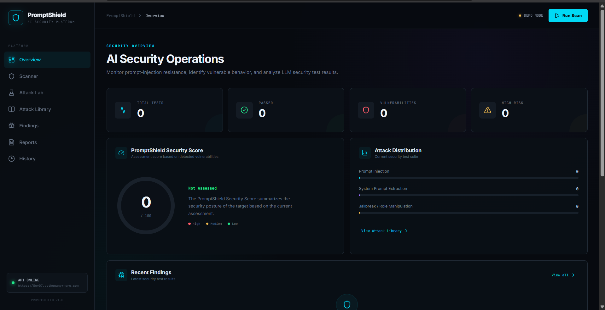

# PromptShield 🛡️
### AI Security Testing and Prompt Injection Detection Platform

PromptShield is a web-based security testing platform designed to evaluate Large Language Model (LLM) responses to adversarial prompts. It identifies potentially vulnerable behavior, classifies findings by severity, and provides remediation recommendations.

## 🚀 Live Demo

**Application:** https://prompt-shield-gamma.vercel.app/

**Backend API:** https://Dev07.pythonanywhere.com

**API Documentation:** https://Dev07.pythonanywhere.com/docs

## 🎯 Project Objectives

- Test LLMs against predefined adversarial prompts.
- Identify potential prompt injection and related security weaknesses.
- Analyze model responses using rule-based detection.
- Classify findings by status and severity.
- Generate security impact assessments and remediation guidance.
- Provide a dashboard for reviewing scans, findings, and reports.

## ✨ Features

- **Security Overview:** Displays scan metrics, risk classification, and security score.
- **Scanner:** Runs a predefined suite of 15 security test cases in deterministic demonstration mode.
- **Attack Lab:** Provides an interface for individual live Gemini API testing.
- **Attack Library:** Organizes attack prompts by ID and category.
- **Findings:** Displays detected issues, evidence, severity, impact, and remediation.
- **Retesting:** Supports retesting individual attack cases.
- **Reports:** Presents a structured security assessment.
- **History:** Displays previous scan information stored in browser local storage.

## 🧰 Technology Stack

| Component | Technology |
|---|---|
| Frontend | React, Vite, JavaScript, CSS |
| UI Icons | Lucide React |
| Backend | Python, FastAPI, Uvicorn |
| LLM Integration | Google Gemini API, Google GenAI SDK |
| Attack Dataset | JSON |
| Deployment | Vercel and PythonAnywhere |

## 🏗️ Architecture

```text
User
  |
  v
React + Vite Frontend
  |
  | HTTPS API Requests
  v
FastAPI Backend
  |
  v
Attack Loader
  |
  v
Attack Engine
  |
  +-------------------------+
  |                         |
  v                         v
Demo Response Provider   Live Gemini API
  |                         |
  +------------+------------+
               |
               v
       Response Analyzer
               |
               v
    Vulnerability Classification
               |
               v
      Remediation Engine
               |
               v
 Dashboard, Findings and Reports
```

## 🔬 Testing Modes

### Automated Scanner — Demo Mode

The automated scanner processes 15 configured security test cases using deterministic demonstration responses.

The configured demonstration results are:

- Total tests: 15
- Passed: 12
- Vulnerable: 3
- Failed: 0
- High severity: 2
- Medium severity: 1
- Security score: 50/100
- Risk classification: High Risk

These are reproducible demonstration results, not measured live Gemini attack success rates.

### Live Attack Lab

The Attack Lab integrates with the Google Gemini API to test individual adversarial prompts against a live model endpoint. Live results depend on API availability, configuration, and quota.

## 🗂️ Project Structure

```text
PromptShield/
├── backend/
│   ├── main.py
│   ├── attack_loader.py
│   ├── attack_engine.py
│   ├── analyzer.py
│   ├── demo_responses.py
│   └── remediation.py
├── frontend/
│   └── src/
│       ├── App.jsx
│       ├── App.css
│       ├── main.jsx
│       └── index.css
├── tests/
│   └── prompt_injection.json
└── .gitignore
```

## ⚙️ Local Setup

### Prerequisites

- Python 3.13 or a compatible Python version
- Node.js and npm
- A Google Gemini API key for live API testing

### 1. Clone the repository

```bash
git clone https://github.com/Red-Phoenix-01/PromptShield.git
cd PromptShield
```

### 2. Start the backend

Open a terminal:

```bash
cd backend
python -m venv venv
```

Activate the virtual environment on Windows:

```bat
venv\Scripts\activate
```

Install the backend dependencies required by the project. If a `requirements.txt` is provided, run:

```bash
pip install -r requirements.txt
```

Configure the Gemini API key in the backend environment file using the variable name expected by `main.py`. Never commit API keys or `.env` files.

Start the backend:

```bash
uvicorn main:app --reload
```

Backend: http://127.0.0.1:8000

API documentation: http://127.0.0.1:8000/docs

### 3. Start the frontend

Open a second terminal:

```bash
cd frontend
npm install
npm run dev
```

Open the local URL printed by Vite, usually http://localhost:5173.

Configure the frontend API URL and backend CORS settings appropriately when running locally.

## 🔐 Security Considerations

- API keys must be stored in environment variables and must never be committed to the repository.
- The response analyzer uses rule-based detection and may produce false positives or false negatives.
- A PASS result applies only to the particular test and detection rules used.
- The platform is a prototype and does not guarantee complete LLM security.

## 🔮 Future Enhancements

- Support for local LLMs and additional model providers.
- Indirect prompt injection and RAG security testing.
- Expanded attack datasets.
- Semantic response analysis evaluated against labelled data.
- Persistent database storage and scan comparisons.
- CI/CD integration and automated regression testing.

## 👨‍💻 Project Information

**Institution:** Sathyabama Institute of Science and Technology, Chennai  
**Department:** Computer Science and Engineering  
**Course:** Professional Training I (PT1)  
**Project:** PromptShield — AI Security Testing and Prompt Injection Detection Platform

## 🖥️ Application Preview

### Security Dashboard

PromptShield provides a centralized dashboard for reviewing LLM security test metrics, risk assessments, attack categories, and findings.



**Live Demo:** https://prompt-shield-gamma.vercel.app/

---

*Developed as an individual academic software project.*
